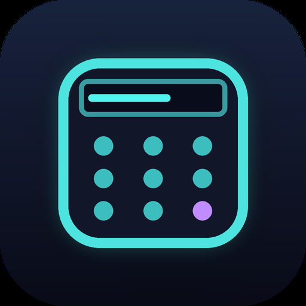

# Neon Calculator 2 — Android app

A production-ready Android build of the **Neon Calculator 2** source package, wrapped with
[Capacitor](https://capacitorjs.com/) so the original neon web UI runs inside a native
Android WebView shell — fully offline, with no ads, no analytics, no login and **no
permissions at all**.

<p align="center">
  
</p>

## Features

- **Neon dark UI** — the original design, unchanged: cyan/purple glow, animated key press.
- **Standard calculator** — AC, ±, %, ÷ × − +, decimal, backspace, equals.
- **Scientific mode** — sin, cos, tan (degrees), √, ln, log, x², xʸ, π, e, parentheses.
- **Piano-like key sounds** — two-oscillator synthesised notes, one per key, generated in
  the Web Audio API. No audio files ship with the app. Toggle with the ♫ button.
- **Unit converter** — Length, Weight and Temperature with a swap button.
- **Calculation history** — last 50 calculations, tap an entry to reload it into the
  keypad. Now persisted across app restarts (local storage only, never leaves the device).
- **Offline by design** — every asset is bundled inside the APK.
- **Native polish** — adaptive launcher icon (Android 8+), themed monochrome icon
  (Android 13+), neon splash screen, dark status/navigation bars, edge-to-edge layout with
  safe-area insets, no rubber-band scrolling, keyboard input supported.

### A bug fixed along the way

The original `index.html` rewrote `ln(` to `Math.log(` and *then* rewrote `log(` to
`Math.log10(`, which corrupted the result into `Math.Math.log10(`. Scientific `ln`/`log`
crashed. The rewrite order is now `log(` → `ln(`, and the fix is covered by a test
(`tools/smoke_test.js`).

## Install the APK

The CI workflow produces two APKs:

| APK | Use |
| --- | --- |
| `NeonCalculator2-1.0.0-release.apk` | Install this one. Release build, signed, no debug suffix. |
| `NeonCalculator2-1.0.0-debug.apk` | Debug build (package id ends in `.debug`, so it can sit side by side). |

Download it from the **Actions** tab → latest *Build Android APK* run → **Artifacts**,
copy it to the phone, and open it. Android will ask you to allow installing apps from your
file manager or browser — that is the normal sideloading prompt. Requires **Android 6.0
(API 23) or newer**, tested configuration targets Android 15 (API 35).

Command line:

```bash
adb install -r NeonCalculator2-1.0.0-release.apk
```

## Permissions

**None.** The generated `AndroidManifest.xml` declares no `<uses-permission>` entries at
all. The web assets are served by AndroidX's `WebViewAssetLoader` from inside the APK, so
the app never opens a network socket. The CI job asserts this and **fails the build** if
`INTERNET`, `ACCESS_NETWORK_STATE`, `AD_ID`, location, camera, microphone or storage
permissions ever appear in the packaged APK. You can check any APK yourself:

```bash
aapt dump permissions NeonCalculator2-1.0.0-release.apk   # prints nothing
```

## Build it yourself

Prerequisites: Node 20+, JDK 21, Android SDK with platform 35 and build-tools 35.0.0.

```bash
npm ci
npm test                 # web logic smoke tests (21 assertions)
npx cap sync android     # copy www/ into android/app/src/main/assets/public
cd android && ./gradlew assembleRelease
```

The APK lands in `android/app/build/outputs/apk/release/`.

Release signing is driven by environment variables, so no key is ever committed:

```bash
export NEON_KEYSTORE_PATH=/path/to/upload.jks
export NEON_KEYSTORE_PASSWORD=...
export NEON_KEY_PASSWORD=...
export NEON_KEY_ALIAS=...
./gradlew assembleRelease
```

Without those variables the release APK is signed with the debug key, so it still installs.

### Building in the cloud (what this repo does)

`.github/workflows/android-build.yml` runs on every push to `main` and on manual dispatch
(**Actions → Build Android APK → Run workflow**). It sets up JDK 21 and the Android SDK,
runs the smoke tests, syncs the web assets, signs the release APK, verifies the packaged
permissions and uploads three artifacts: the release APK, the debug APK, and the signing
key. The key artifact includes `keystore-info.txt` with its alias and password — keep it,
because reusing the same key is what lets a future build install *over* an existing copy.
To have CI use your own upload key instead, add the repository secrets
`NEON_KEYSTORE_BASE64` (`base64 -w0 your.jks`), `NEON_KEYSTORE_PASSWORD` and
`NEON_KEY_ALIAS`.

## Project layout

```
www/index.html            the app (patched from the original source, neon UI preserved)
capacitor.config.json     Capacitor + splash screen configuration
tools/make_assets.py      regenerates every icon and splash screen (pure Pillow)
tools/patch_web.py        applies the Android hardening patches to the source HTML
tools/smoke_test.js       headless tests for the calculator engine and converter
android/                  the Capacitor Android project
  app/src/main/AndroidManifest.xml      zero permissions
  app/src/main/res/values/styles.xml    neon theme, edge-to-edge, splash theme
  app/src/main/res/mipmap-*/            launcher icons (all densities + adaptive)
  app/src/main/res/drawable*/splash.png splash screens (portrait + landscape)
store/play_icon_512.png   512×512 icon for store listings
```

Regenerate the artwork after editing `tools/make_assets.py`:

```bash
python3 tools/make_assets.py
```

## How the source was changed

The web app in `www/index.html` is the original file with a small, auditable set of
patches (`tools/patch_web.py`), all of them additive:

1. Safe-area insets so nothing hides under the status bar, notch or gesture bar.
2. `overscroll-behavior: none`, no tap highlight, no text selection on keys — native feel.
3. Sound preference and history persisted in `localStorage`; audio context unlocked on the
   first user gesture so the piano notes work on Android WebView.
4. The `ln`/`log` rewrite-order bug fixed.
5. Viewport set to `viewport-fit=cover` for true edge-to-edge rendering.

Everything else — the neon styling, keypad, scientific keys, note synthesis, converter and
history behaviour — is untouched.

## Licence

MIT — see [LICENSE](LICENSE). The app contains no third-party analytics, ad or tracking
SDKs. Capacitor, AndroidX and the SplashScreen library are the only runtime dependencies.
